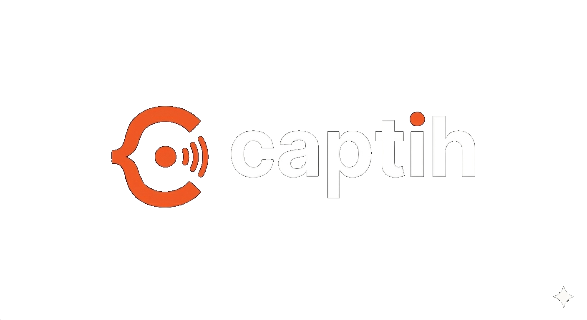
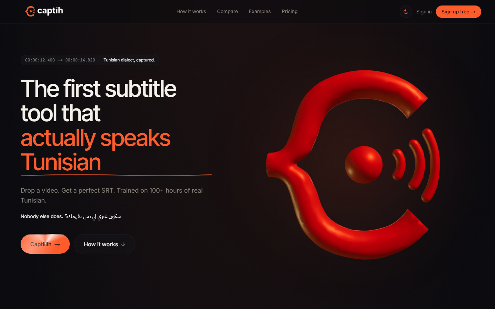
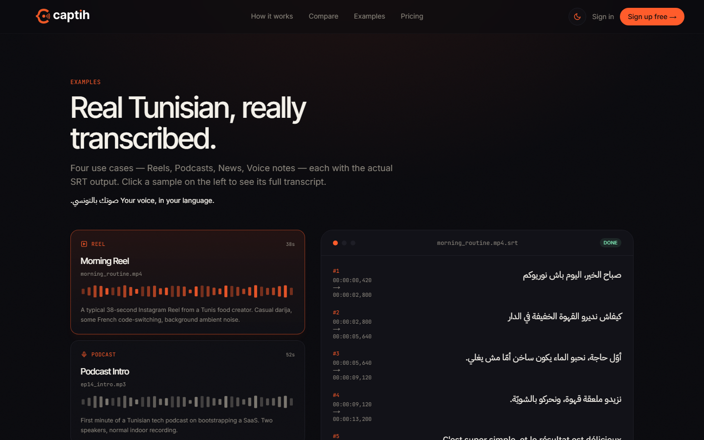

<p align="center">
  
</p>

<h1 align="center">captih</h1>

<p align="center">
  <strong>Subtitles and transcripts for Tunisian Arabic (Darija).</strong><br/>
  Drop a video or audio file, get a timed <code>.srt</code> and a clean transcript.
</p>

<p align="center">
  <a href="https://captih.vercel.app"><strong>Live app</strong></a> ·
  <a href="docs/ARCHITECTURE.md">Architecture</a> ·
  <a href="#team">Team</a>
</p>

<p align="center">
  <a href="https://captih.vercel.app"></a>
  <a href="https://github.com/FARUKxKUN/CAPTIH-SaaS/actions/workflows/ci.yml"></a>
  
  
  
  
</p>



---

## The problem

Tunisian Darija is a spoken dialect that mixes Arabic with French and some English, often in the same sentence. General speech-to-text tools (YouTube auto-captions, Otter, Descript) are trained on Modern Standard Arabic or other dialects, and they produce unusable output for Tunisian speech. Tunisian creators, podcasters and journalists end up subtitling by hand.

## What captih does

1. A user uploads a video or audio file (MP4, MOV, MP3, WAV, M4A, WebM).
2. The audio is transcribed by **FARUKxAUTO**, a Whisper large-v3 model fine-tuned on about 93 hours of transcribed Tunisian Darija, running on a serverless GPU.
3. The output gets word-level timestamps, then a conservative LLM proofreading pass that is not allowed to invent words.
4. The user previews the result, re-chunks captions live (by words or characters), edits text in an inline editor, and downloads SRT or TXT.

Billing is pay-as-you-go: users buy minute packs in Tunisian dinars through a local payment provider, and minutes are refunded automatically if a transcription fails.



## Engineering highlights

- **Fail-safe AI post-processing.** Gemini cleans the raw transcript, but its output is only accepted if it returns exactly the same number of segments in the same order. Otherwise the original is kept, so timestamps can never drift and a confident wrong guess never replaces what the model actually heard. ([`src/lib/gemini-cleanup.ts`](src/lib/gemini-cleanup.ts))
- **Billing integrity.** The client-declared duration is never trusted. After transcription, the charge is reconciled against the real length (last word timestamp) and any shortfall is collected. Failed or silent jobs refund automatically. ([`src/app/api/transcribe/route.ts`](src/app/api/transcribe/route.ts))
- **Secure payment webhooks.** The payment webhook verifies an HMAC-SHA256 signature with a timing-safe comparison, rejects events older than 5 minutes (replay protection) and dedupes on the webhook id (idempotency). Credits are granted only from this verified path. ([`src/app/api/webhooks/dhmad/route.ts`](src/app/api/webhooks/dhmad/route.ts))
- **Defence in depth on uploads.** Same-origin check, per-IP rate limiting backed by Postgres (works across serverless instances), size limits checked before buffering, MIME allow-list and magic-byte sniffing so a renamed file can't get through.
- **Per-request nonce CSP.** A strict Content Security Policy with a fresh nonce per request, plus HSTS, frame denial and a locked-down Permissions-Policy. ([`src/proxy.ts`](src/proxy.ts), [`next.config.ts`](next.config.ts))
- **Row Level Security** on every table, with server-only privileged access for webhooks.
- **Considered front end.** A 3D logo in React Three Fiber, GSAP and Lenis scroll choreography, light and dark themes, a usage dashboard with charts, and an RTL-aware transcript editor with auto-save.

## Tech stack

| Layer | Technology |
|---|---|
| App | Next.js 16 (App Router), React 19, TypeScript |
| Styling and motion | Tailwind CSS v4, GSAP, Lenis, React Three Fiber |
| Auth | Clerk (synced to the database through a signed webhook) |
| Database | Supabase Postgres with Row Level Security |
| Speech-to-text | FARUKxAUTO (fine-tuned Whisper large-v3) on Modal serverless GPUs |
| Post-processing | Gemini 2.5 Flash, constrained proofreading |
| Payments | Dhmad.tn (Tunisian escrow and checkout) |
| Analytics | PostHog (EU region) |
| Hosting | Vercel |

## How it works

```
Browser ──upload──▶ /api/transcribe (Next.js on Vercel)
                     │  same-origin + rate limit + Clerk auth
                     │  size / MIME / magic-byte checks
                     │  reserve minutes (Supabase)
                     ▼
              Modal GPU endpoint ──▶ FARUKxAUTO ──▶ word-level timestamps
                     │
                     ▼
              reconcile billing ──▶ Gemini proofreading (1:1 guard)
                     │
                     ▼
              store job (Supabase) ──▶ result page: preview, re-chunk, edit, export SRT/TXT
```

The full request flow, data model, API reference and security model are in [`docs/ARCHITECTURE.md`](docs/ARCHITECTURE.md).

## Repository layout

```
src/
  app/            Pages and API routes (App Router)
    api/          transcribe, jobs, credits, payments, webhooks
  components/     Landing sections, dashboard widgets, auth, motion primitives
  lib/            Domain logic: credits, jobs, captions, payments, rate limiting
  proxy.ts        Auth gating + nonce CSP (Next 16 "proxy", formerly middleware)
supabase/
  migrations/     Database schema, RLS policies and SQL functions
docs/             Architecture notes and screenshots
```

## What is not in this repository

The model and the data behind it are kept private:

- the FARUKxAUTO model weights and fine-tuning pipeline,
- the transcribed Tunisian Darija training corpus,
- the Modal inference service.

The app calls the inference service over an authenticated HTTP endpoint configured through environment variables.

## Running locally

This is a production app wired to several hosted services, so a full local run needs your own accounts for Clerk, Supabase and (for transcription) a compatible inference endpoint.

```bash
npm install
cp .env.example .env.local   # fill in your own keys
npm run dev                  # http://localhost:3000
```

Apply the SQL files in [`supabase/migrations/`](supabase/migrations/) to a fresh Supabase project (see [`supabase/README.md`](supabase/README.md)). Without the inference endpoint, the landing page, examples, auth and dashboard still run.

## Status and roadmap

captih is live and in early use. Current limits and the next steps:

- **Files up to 30 minutes, processed synchronously.** Next: an async job queue with direct-to-storage uploads and chunked parallel inference, for long files such as full podcast episodes.
- **Server-side duration probing** (ffprobe) before charging, instead of reconciling after transcription.
- **Speaker labels and timestamp editing** in the editor.
- **More dialects** (Algerian, Moroccan, Libyan) using the same fine-tuning approach.

## Team

captih was built by two engineering students at ISI Mahdia, Tunisia.

| | Role | Main contributions |
|---|---|---|
| **Farouk Battikh** ([@FARUKxKUN](https://github.com/FARUKxKUN)) | Product, front end, ML | Product and brand design, the full front end (landing, 3D logo, motion, dashboard, editor, result page), the FARUKxAUTO fine-tune and its inference service, billing reconciliation, payment checkout fixes, security hardening |
| **Yassine Bouteraa** ([@yassinebouteraa](https://github.com/yassinebouteraa)) | Back end | Backend architecture: Clerk authentication and user sync, the Supabase schema, RLS and SQL functions, the credit and job systems, the Modal transcription integration, the Dhmad payment flow and webhook, PostHog analytics, Gemini cleanup and caption formatting |

## License

Copyright (c) 2026 Farouk Battikh and Yassine Bouteraa. **All rights reserved.**

This source code is published for viewing and evaluation only. It is not open source: you may not copy, modify, distribute, or deploy it, in whole or in part, without written permission from the authors. See [`LICENSE`](LICENSE).
